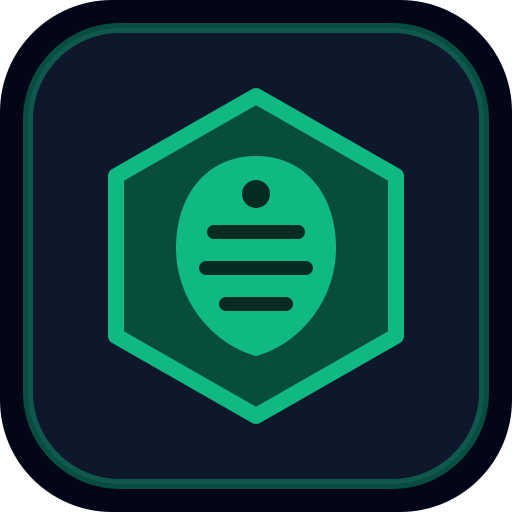

# Biopond BSF



**Aplikasi Manajemen Budidaya Maggot Black Soldier Fly (BSF) 100% Offline-First untuk Skala Rumahan & Komunitas.**

[](https://www.gnu.org/licenses/gpl-3.0.html)
[](https://github.com/aiprojek/Biopond-BSF)
[](https://github.com/aiprojek/Biopond-BSF)

---

## 👋 Tentang Biopond BSF

**Biopond BSF** adalah aplikasi web **Progressive Web App (PWA)** berdesain *mobile-first* yang dirancang khusus untuk membantu peternak maggot *Black Soldier Fly* (BSF) skala rumahan maupun komunitas. Tampilan Dark Mode kontras tinggi (nuansa slate gelap dan hijau zamrud) dibuat agar tetap nyaman dibaca di area kandang maupun luar ruangan.

Aplikasi ini bekerja **100% secara lokal (*offline-first*)** setelah dimuat pertama kali. Seluruh data wadah, batch biopond, log sampah organik, stok pakan, hasil panen, tim operator, dan keuangan disimpan aman di browser perangkat Anda (**IndexedDB** & `localStorage`), sehingga tetap dapat digunakan penuh tanpa koneksi internet.

Dikembangkan oleh **[AI Projek](https://www.aiprojek01.my.id/)** secara terbuka di repositori **[aiprojek/Biopond-BSF](https://github.com/aiprojek/Biopond-BSF)**.

---

## ✨ Fitur Utama

- **📴 100% Offline-First PWA**: Seluruh pustaka UI & database di-hosting lokal dan langsung di-cache oleh Service Worker (`sw.js`) tanpa ketergantungan CDN eksternal, lengkap dengan **Export/Import Backup JSON**.
- **🪣 Master Wadah Permanen & 2 Prinsip Lindi**: Simpan profil wadah permanen (`W-001`, dst.) agar memulai batch baru cukup 1 ketuk tanpa mengetik ulang nama. Mendukung kategori **Menghasilkan Air Lindi** dan **Tanpa Air Lindi** dengan preset (*Ember Susun*, *Ember False Bottom*, *Ember Biasa*, *Bak / Rak*) maupun tipe **Lainnya (Kustom)**.
- **📊 Dashboard, Checklist Harian & Peringatan Lingkungan**: Pantau metrik *real-time* (Biopond Aktif, Total Sampah Terurai, Panen Maggot Segar, Air Lindi), tugas harian otomatis sesuai umur batch, serta peringatan suhu, kelembapan, pH ekstrem, dan stok menipis.
- **📅 Batch Tracker & Timeline Rotasi (Gantt View)**: Pantau umur batch (`Hari ke-X`), fase otomatis (`Penetasan H1–5`, `Pembesaran H6+`), marka pindah media & target panen dalam rentang 14/21/30 hari.
- **📷 Dokumentasi Foto WebP & Ergonomi Lapangan**: Tombol **Scan QR Instan** di header, chip **Quick-Add** (`+1`, `+2`, `+5`, `+10`, `+20 kg`/liter), preset suhu/pH 1-ketuk, dan lampiran foto media yang dikompresi otomatis ke WebP ringan.
- **📦 Gudang Stok Pakan Berbasis Buku Mutasi (`feed_ledger`)**: Setiap stok masuk (`in`) dan pemakaian harian (`out`) dicatat terpisah dan dihitung ulang otomatis agar aman dari *lost-update* saat sinkronisasi multi-perangkat.
- **📈 Analisis Performa Siklus (FCR, Rendemen, Reduksi & WRI)**: Hitung efisiensi biokonversi dan lihat grafik perbandingan performa antar tipe wadah (termasuk kustom), kategori lindi, dan zona kandang.
- **📄 Laporan Bulanan PDF A4 & Ekspor CSV Excel**: Cetak rekap sampah, panen (maggot, kasgot, lindi, telur), HPP, dan transaksi bulanan ke PDF A4 atau ekspor ke CSV Excel (UTF-8 BOM).
- **👥 Tim Operator, PIN Staf & Mode Pekerja Kandang**: PIN mandiri per staf & pemilik (hash SHA-256 lokal dengan jeda lockout *brute-force*), mode pemulihan lupa PIN, serta **Mode Pekerja Kandang** untuk menyembunyikan data Keuangan/HPP dan kredensial sensitif.
- **🧮 Kalkulator Budidaya BSF (4 Mode)**: **Penetasan (Nursery)**, **Daya Makan Harian**, **Kapasitas Industri (Kuintal–Ton)**, dan **Maggot Kering & BEP Harga Jual**.
- **🤖 Diagnosa AI Multi-Provider + Vision AI (BYOK)**: Hubungkan API Key Anda sendiri untuk **Google Gemini**, **OpenRouter**, **Groq**, atau **OpenAI** beserta lampiran foto kondisi media dan konteks suhu/pH terbaru.
- **🏷️ Cetak Label QR, Barcode 1D & Label General (Spidol)**: Cetak label batch maupun **Label General Reusable** berisi QR permanen (`BSF-WADAH:W-001`) + Barcode Code-39 + kotak isian spidol yang hemat kertas.
- **🔔 Notifikasi Lokal PWA & Google Calendar / `.ICS`**: Pengingat harian langsung di browser maupun ekspor ke kalender OS agar alarm tetap berbunyi meski aplikasi ditutup.
- **☁️ Sinkronisasi Cloud & Kode Pairing Cepat**: Sinkron antar HP/PC via **Cloudflare (`/api/sync` KV/R2)**, **Dropbox (OAuth2 PKCE)**, atau **WebDAV**, lengkap dengan **Kode Pairing 8 karakter / QR (`BSFPAIR:v1:...`)** dengan pilihan peran Pemilik atau Pekerja Kandang.

---

## 🚀 Panduan Cepat

1. **Atur Profil Awal**: Buka aplikasi lalu isi nama peternakan & kota (atau lewati dan lengkapi nanti lewat **Pengaturan**).
2. **Daftarkan Wadah & Mulai Batch**: Masuk ke tab **Biopond**, ketuk **+ Tambah Biopond / Batch**, pilih tipe wadah (*Menghasilkan Air Lindi* atau *Tanpa Air Lindi*), isi tanggal tebar dan gramasi telur.
3. **Catat Aktivitas Harian**: Gunakan **Checklist Harian**, tombol **Catat Sampah** (bisa disertai foto media, suhu/pH, dan lindi), atau ketuk **Scan QR** di header untuk langsung membuka wadah terkait.
4. **Pantau Timeline & Panen**: Cek jadwal rotasi di sub-tab **Timeline (Gantt)**, catat hasil panen maggot/kasgot/lindi, lalu tinjau angka **FCR**, **WRI**, dan **Keuangan/HPP**.
5. **Amankan Data**: Unduh cadangan berkala lewat **Export JSON** atau aktifkan **Sinkronisasi Cloud** + **Kode Pairing** jika memakai lebih dari satu perangkat.

---

## 💻 Instalasi Aplikasi (PWA) & Mode Lokal

### Instal sebagai Aplikasi (PWA)
Dapatkan akses cepat dari layar utama dan dukungan penuh offline:
- **Desktop (Chrome / Edge)**: Klik ikon **Instal** di bilah alamat browser, lalu konfirmasi.
- **Mobile (Android / Chrome)**: Buka menu browser (`⋮`) → pilih **Instal aplikasi** atau **Tambahkan ke layar utama**.
- **Mobile (iOS / Safari)**: Ketuk tombol **Bagikan (Share)** → pilih **Tambahkan ke Layar Utama (Add to Home Screen)**.

### Menjalankan Secara Lokal / Tanpa Backend
Aplikasi ini berjalan **100% resilien tanpa backend**. Ketika `/api/register`, `/api/config`, atau `/api/sync` tidak tersedia (misalnya saat dijalankan lokal atau offline total), seluruh fitur pencatatan, kalkulator, ekspor `.ics`, backup JSON, dan Diagnosa AI (BYOK) tetap berjalan normal.

```bash
# Opsi A: Static server sederhana
npx serve .
# atau
python3 -m http.server 3000

# Opsi B: Vite Dev Server (proyek build)
npm install
npm run dev
```

Lalu buka `http://localhost:3000` di browser Anda.

---

## 🛠️ Tumpukan Teknologi

- **Core App**: HTML5, Vanilla JavaScript (ES Modules), Vite
- **Styling**: Tailwind CSS (bundled lokal via `@tailwindcss/vite`)
- **Penyimpanan Lokal**: Dexie.js (IndexedDB) & `localStorage`
- **Ikon & QR**: Lucide Icons & `qrcode-generator` (bundled lokal)
- **Offline PWA**: Service Worker (`vite-plugin-pwa` / Workbox precache)
- **Backend Opsional**: Cloudflare Pages Functions (`KV` / `R2`), Google Apps Script

---

## ⚙️ Panduan Deployment & Backend (Opsional untuk Pengelola Hosting)

Bagian di bawah ini ditujukan bagi pemilik/pengelola hosting yang ingin men-deploy proyek ke **Cloudflare Pages** beserta endpoint serverless opsional.

### 1. Struktur Folder Repositori

```text
biopond-bsf/
├── index.html                  # Seluruh aplikasi PWA (UI, Dexie.js, AI BYOK, analitik WRI/FCR & Pairing)
├── src/                        # Entry CSS Tailwind lokal & registrasi Service Worker
├── public/                     # Ikon PWA & vendor lokal (/vendor/dexie.min.js, lucide.min.js, qrcode.js)
├── functions/                  # Cloudflare Pages Functions (Serverless Backend)
│   └── api/
│       ├── register.js         # POST /api/register (telemetri) & GET /api/register (cek status)
│       ├── config.js           # GET /api/config -> mengirim GOOGLE_CLIENT_ID & DROPBOX_APP_KEY
│       └── sync.js             # GET/PUT /api/sync -> sinkronisasi multi-device & relay Pairing KV/R2
└── README.md                   # Dokumentasi proyek
```

---

### 2. Setup Backend Telemetri Google Sheets (Khusus Pemilik Aplikasi)

Bagian ini **khusus untuk pemilik/pengelola hosting aplikasi** (bukan panduan pengguna akhir), jika Anda ingin mencatat statistik komunitas pengguna baru secara opsional ke Google Sheets.

#### Langkah A: Siapkan Google Sheets
1. Buka [Google Sheets](https://sheets.google.com) dan buat **Spreadsheet baru** (misal beri nama `Telemetri Komunitas Biopond BSF`).
2. *(Opsional)* Ubah nama tab sheet pertama menjadi `Users` (jika dibiarkan `Sheet1`, script tetap otomatis memakainya). **Header kolom A–F tidak perlu diisi manual** karena akan dibuat otomatis oleh script saat data pertama masuk.

#### Langkah B: Buat Google Apps Script (GAS)
1. Di dalam Google Sheets tadi, klik menu **Extensions (Ekstensi)** → **Apps Script**.
2. Hapus kode default di editor, lalu salin dan tempel kode berikut:

```javascript
function ensureHeaders_(sheet) {
  var headers = ['timestamp', 'device_id', 'nama', 'kota', 'location', 'timezone'];
  if (sheet.getLastRow() === 0) {
    sheet.appendRow(headers);
    sheet.getRange(1, 1, 1, headers.length).setFontWeight('bold');
    sheet.setFrozenRows(1);
    return;
  }

  var firstRow = sheet.getRange(1, 1, 1, headers.length).getValues()[0];
  var hasHeader =
    String(firstRow[0]).trim() === 'timestamp' &&
    String(firstRow[1]).trim() === 'device_id';

  if (!hasHeader) {
    sheet.insertRowBefore(1);
    sheet.getRange(1, 1, 1, headers.length).setValues([headers]).setFontWeight('bold');
    sheet.setFrozenRows(1);
  }
}

function doPost(e) {
  var lock = LockService.getScriptLock();
  lock.waitLock(10000);

  try {
    var ss = SpreadsheetApp.getActiveSpreadsheet();
    var sheet = ss.getSheetByName('Users') || ss.getSheets()[0];

    ensureHeaders_(sheet);

    var data = JSON.parse((e && e.postData && e.postData.contents) || '{}');
    var timestamp = new Date().toISOString();
    var deviceId = String(data.device_id || '');

    // Cari apakah device_id sudah ada di sheet (kolom B) untuk update data
    var values = sheet.getDataRange().getValues();
    var rowIndex = -1;
    for (var i = 1; i < values.length; i++) {
      if (values[i][1] === deviceId && deviceId !== '') {
        rowIndex = i + 1; // 1-indexed baris spreadsheet
        break;
      }
    }

    if (rowIndex > 0) {
      // Perbarui data pengguna yang ada (misal setelah isi profil di Pengaturan)
      sheet.getRange(rowIndex, 1).setValue(timestamp);
      if (data.nama && data.nama !== 'Anonim') sheet.getRange(rowIndex, 3).setValue(data.nama);
      if (data.kota && data.kota !== 'none') sheet.getRange(rowIndex, 4).setValue(data.kota);
      if (data.location && data.location !== 'none') sheet.getRange(rowIndex, 5).setValue(data.location);
      if (data.timezone) sheet.getRange(rowIndex, 6).setValue(data.timezone);
    } else {
      // Tambah baris baru (saat pertama buka / skip onboarding)
      sheet.appendRow([
        timestamp,
        deviceId,
        data.nama || 'Anonim',
        data.kota || 'none',
        data.location || 'none',
        data.timezone || ''
      ]);
    }

    return ContentService
      .createTextOutput(JSON.stringify({ status: 'success' }))
      .setMimeType(ContentService.MimeType.JSON);
  } catch (err) {
    return ContentService
      .createTextOutput(JSON.stringify({ status: 'error', message: err.toString() }))
      .setMimeType(ContentService.MimeType.JSON);
  } finally {
    lock.releaseLock();
  }
}
```

#### Langkah C: Deploy sebagai Web App
1. Klik **Save (Simpan)** dan beri nama proyek, misalnya `BSF Telemetry Webhook`.
2. Klik **Deploy** → **New deployment** (jika memperbarui script lama: **Manage deployments → Edit → Version: New version → Deploy**).
3. Pilih tipe **Web app** dengan pengaturan:
   - **Execute as**: `Me (akun Google Anda)`
   - **Who has access**: **Anyone (Siapa saja)** *(wajib agar Cloudflare Pages Function dapat mengirim POST tanpa login)*.
4. Klik **Deploy** → **Authorize access**, lalu salin **Web app URL** (`https://script.google.com/macros/s/.../exec`) untuk dipasang sebagai `GAS_WEBHOOK_URL` di Cloudflare Pages.

---

### 3. Setup Google Cloud Console (`GOOGLE_CLIENT_ID` untuk Google Calendar)

1. Buka [Google Cloud Console](https://console.cloud.google.com/) dan buat project baru (misal `Biopond BSF App`).
2. Buka **APIs & Services → Library** → aktifkan **Google Calendar API**.
3. Konfigurasikan **OAuth consent screen** (tipe **External**) dengan scope `https://www.googleapis.com/auth/calendar.events`.
4. Buka **Credentials → + CREATE CREDENTIALS → OAuth client ID** (tipe **Web application**):
   - Tambahkan **Authorized JavaScript origins** (`http://localhost:3000`, `https://nama-proyek-anda.pages.dev`, dll.).
   - Tidak perlu *Authorized redirect URIs* (alur token client-side Google Identity Services).
5. Salin **Client ID** (`.apps.googleusercontent.com`) sebagai `GOOGLE_CLIENT_ID`.

---

### 4. Deploy ke Cloudflare Pages, Secret Key & Cloud Sync

#### Langkah A: Hubungkan Repositori ke Cloudflare Pages
1. Push repositori ini ke GitHub Anda (`index.html`, `public/`, `src/`, `functions/`).
2. Buka [Cloudflare Dashboard](https://dash.cloudflare.com/) → **Workers & Pages → Create → Pages → Connect to Git** → pilih repositori.
3. Pengaturan build:
   - **Framework preset**: `Vite` (atau `None` jika menyajikan statis langsung)
   - **Build command**: `npm run build`
   - **Build output directory**: `dist`
4. Klik **Save and Deploy**.

#### Langkah B: Pasang Environment Variables & Secrets
Buka proyek di **Cloudflare Pages → Settings → Environment variables** (untuk **Production** dan **Preview** jika dipakai):
- **`GAS_WEBHOOK_URL`** *(centang Encrypt)*: URL Web App Google Apps Script (`https://script.google.com/macros/s/.../exec`).
- **`GOOGLE_CLIENT_ID`**: Client ID OAuth 2.0 dari Google Cloud Console.
- **`DROPBOX_APP_KEY`** *(opsional)*: App Key dari Dropbox App Console agar terisi otomatis di menu Pengaturan.
- **`SYNC_TOKEN`** *(opsional, centang Encrypt)*: Bearer token untuk memproteksi endpoint `/api/sync`.

Setelah menyimpan variabel, buka tab **Deployments** lalu klik **Retry deployment** agar aktif di Functions. Anda dapat mengecek status `GAS_WEBHOOK_URL` dengan membuka `https://domain-anda.pages.dev/api/register` (`{"ok":true,"configured":true}`).

#### Langkah C: Aktivasi Cloud Sync Multi-Perangkat
Di menu **Pengaturan → Sinkronisasi Antar Perangkat (Cloud)**, tersedia 3 pilihan layanan:
1. **Cloudflare (`/api/sync`)**: Di Cloudflare Pages → **Settings → Bindings**, tambahkan **KV Namespace** bernama **`BSF_SYNC_KV`** atau **R2 Bucket** bernama **`BSF_SYNC_R2`**.
2. **Dropbox (OAuth2 PKCE & Folder Sync)**: Buat App di [Dropbox App Console](https://www.dropbox.com/developers/apps) (*Scoped access* → *App folder*, centang `files.content.write`, `files.content.read`, `files.metadata.read`), lalu hubungkan memakai **App Key** tanpa *App secret*.
3. **WebDAV (Nextcloud / OwnCloud / NAS)**: Masukkan URL file JSON WebDAV, Username, dan App Password (pastikan CORS diizinkan pada server WebDAV).
4. **Kode Pairing Cepat**: Ketuk **"Buat Kode Pairing / QR untuk HP ke-2"** untuk mendapatkan Kode Pendek 8 karakter (`4829-K7M9`, terenkripsi AES-GCM TTL 15 menit) atau token QR **`BSFPAIR:v1:...`** lengkap dengan pilihan peran Pemilik / Pekerja Kandang.

---

## 📐 Standar Pemversian & Panduan Rilis (Semantic Versioning)

Untuk menjaga konsistensi pengembangan jangka panjang, **Biopond BSF** menggunakan standar **Semantic Versioning (`MAJOR.MINOR.PATCH`)** — misalnya `2.7.0` (ditampilkan di antarmuka sebagai `v2.7.0`).

### Aturan Kenaikan Nomor Versi
- **`MAJOR` (`X.0.0`)**: Perubahan besar yang merombak arsitektur utama, alur inti aplikasi, atau perubahan format data yang tidak kompatibel mundur (*breaking change*).
- **`MINOR` (`2.X.0`)**: Penambahan fitur baru atau peningkatan modul fungsional yang tetap kompatibel dengan data sebelumnya *(contoh: Master Wadah Permanen, Timeline Rotasi Gantt, dukungan wadah kustom)*.
- **`PATCH` (`2.7.X`)**: Perbaikan bug, penyempurnaan teks/UI, atau peningkatan reliabilitas tanpa mengubah perilaku fitur besar *(contoh: perbaikan deteksi respons `/api/register`, penyesuaian layout modal)*.

### Prinsip Pemisahan Versi Aplikasi vs Skema Database Internal
- **Antarmuka pengguna (UI), toast, & diagnostik** hanya menampilkan **versi aplikasi SemVer** (`v2.7.0`) dan **tidak menampilkan versi skema database internal** (`DB vX` / `IndexedDB vX`).
- Versi skema internal (`db.version(...)` di Dexie dan `schemaVersion` di snapshot JSON sync/backup) tetap dikelola di dalam kode semata-mata untuk migrasi database lokal otomatis dan kompatibilitas data antar perangkat.

### Checklist Setiap Kali Menaikkan Versi Rilis
Sebelum melakukan commit/deploy rilis baru, pastikan **3 titik berikut selalu sinkron**:
1. **`package.json`** → field `"version": "X.Y.Z"`
2. **`index.html`** → konstanta `const APP_VERSION = 'X.Y.Z';` dan fallback teks badge `#about-app-version` (`vX.Y.Z`) di modal **Tentang Aplikasi**
3. **`README.md`** → badge versi di bagian atas serta ringkasan rilis pada tabel **Riwayat Versi** di bawah ini

### Riwayat Versi

| Versi | Ringkasan Perubahan |
| :--- | :--- |
| **`v2.7.0`** | Standarisasi versi SemVer (`2.7.0`), penghapusan label versi DB dari UI, perbaikan reliabilitas & status cek `/api/register`, pembaruan informasi pengembang & lisensi GNU GPL 3, serta penyempurnaan Master Wadah Permanen & 2 prinsip lindi. |

---

## 🤝 Kontribusi & Dukungan

Biopond BSF adalah proyek sumber terbuka yang dikembangkan untuk membantu peternak maggot BSF di Indonesia. Kontribusi dan dukungan Anda sangat kami hargai!

- ⭐ **Beri Bintang di GitHub**: Bantu tingkatkan visibilitas proyek dengan memberi bintang pada [repositori ini](https://github.com/aiprojek/Biopond-BSF).
- 🐞 **Laporkan Bug atau Usulkan Fitur**: Jika Anda menemukan kendala atau punya usulan fitur baru, silakan buka *issue* baru di [halaman Issues kami](https://github.com/aiprojek/Biopond-BSF/issues).
- 💻 **Berkontribusi Kode**: Jika ingin ikut membantu pengembangan, silakan *fork* repositori ini dan ajukan *pull request*.
- 💬 **Komunitas**: Bergabung dan berdiskusi bersama pengguna lain di [grup Telegram AI Projek Community](https://t.me/aiprojek_community/32).
- ☕ **Donasi**: Dukung keberlanjutan pengembangan proyek melalui [halaman Lynk.id AI Projek](https://lynk.id/aiprojek/s/bvBJvdA).

---

## 📄 Lisensi

Proyek ini dilisensikan di bawah **GNU General Public License v3.0**. Lihat detail lengkapnya pada halaman [GNU GPL v3.0](https://www.gnu.org/licenses/gpl-3.0.html).

---

Dikembangkan dengan ❤️ oleh [AI Projek](https://www.aiprojek01.my.id/) untuk komunitas budidaya BSF.
